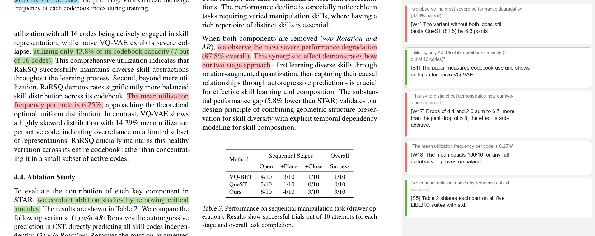
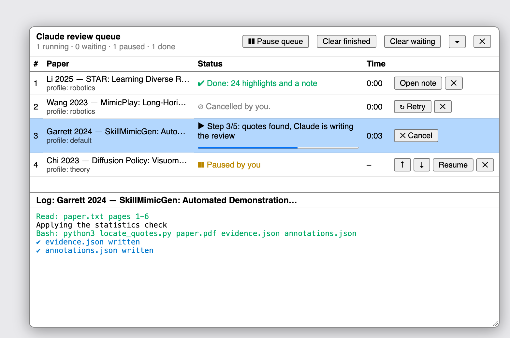
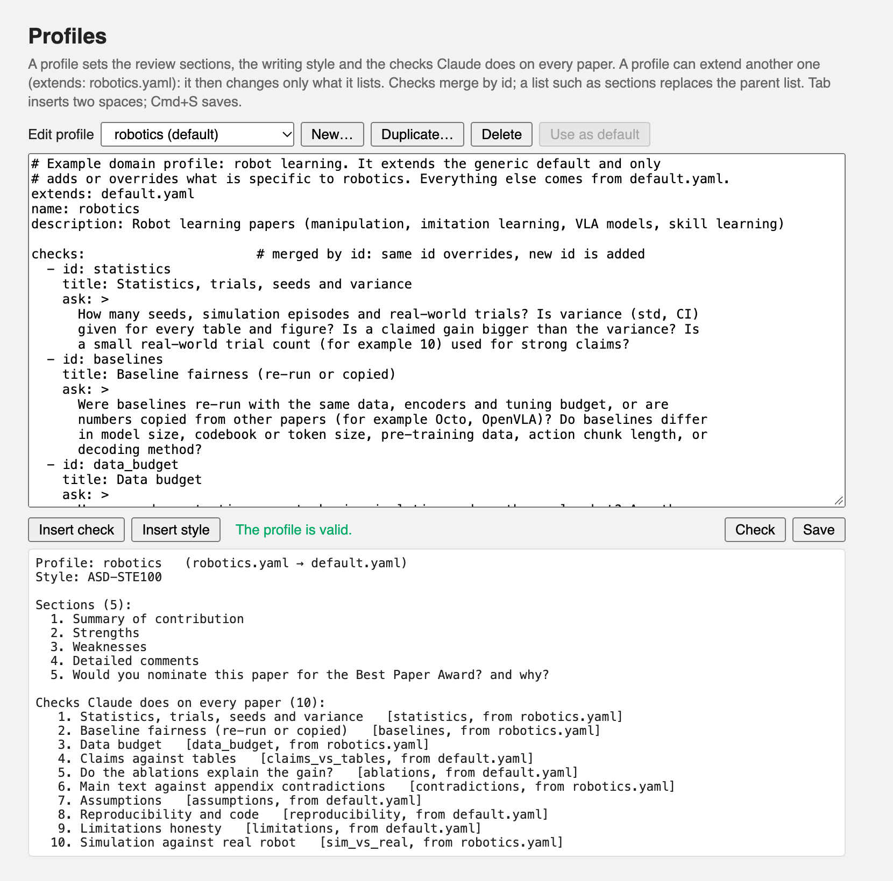
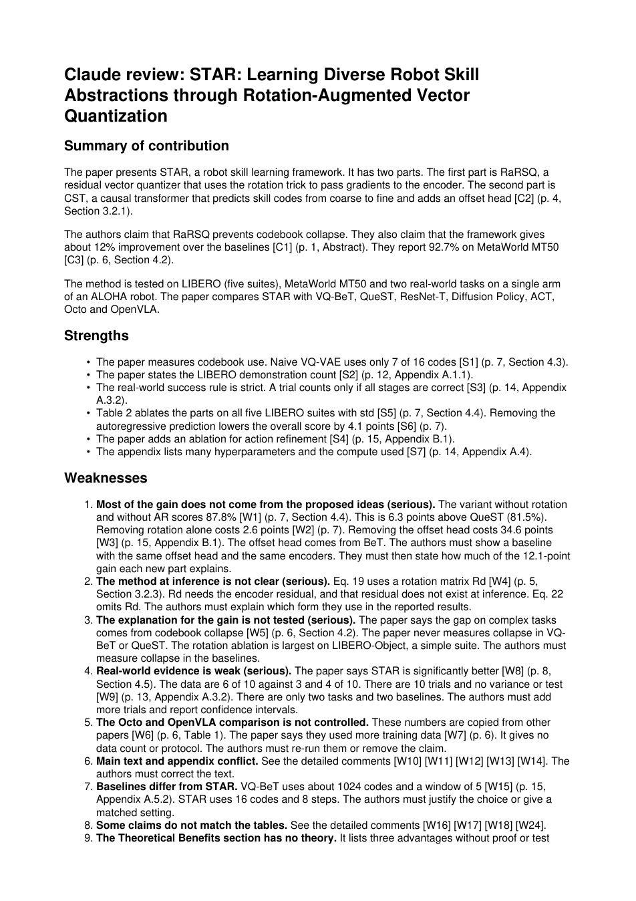

# Review with Claude for Zotero

Right-click a paper in Zotero, choose **Review with Claude**, and get a structured, evidence-based review back **inside Zotero**:

- real **highlight annotations** on the PDF, one per piece of evidence, coloured by type, with a tagged comment such as `[W2] Ablation shows rotation explains little of the gain`;
- a **child note** with the full review, where every evidence tag is a link that jumps to its highlight;
- optionally the review as an attached **PDF**.

The review is written by [Claude Code](https://code.claude.com) running on your own computer (`claude -p`) with your **Claude Pro/Max subscription**, not an API key. What the review looks at (sections, checks, writing style) is set in a small **YAML profile** that you can edit, so the tool is not tied to one field.



*A page of a public arXiv paper (arXiv:2506.03863) with the highlights the skill generated, and their comments as Zotero shows them in the annotation sidebar. The page excerpt is shown only to demonstrate the output. The picture was composed from the real `annotations.json` in [`examples/star-paper`](examples/star-paper).*

## How it works

```
Zotero (right-click)                                     your Mac
   │  copy the PDF + profile to a temp folder
   ▼
claude -p "/paper-review …"  ──►  skill "paper-review"
   (subscription, no API key)        1. extract text with page numbers (PyMuPDF)
                                     2. apply the profile's checks, write evidence.json
                                     3. locate_quotes.py finds every quote in the PDF
                                        → Zotero annotation JSON (rects in PDF space)
                                     4. write review.md, build note.html + review.pdf
   ▲                                  └── result.json  (the contract the plugin reads)
   │
Zotero.Annotations.saveFromJSON  +  child note with links  +  optional PDF attachment
```

The important rule: **every claim in the review must cite evidence** (a tag such as `[W2]`, the page, the section, and a short word-for-word quote of fewer than 15 words). `locate_quotes.py` searches each quote in the PDF text and **fails loudly** if one is not found. It never guesses a position. So every highlight sits on text that really is in the paper. Details are in [docs/HOW_IT_WORKS.md](docs/HOW_IT_WORKS.md).

| Highlight colour | Meaning | Tag |
|---|---|---|
| yellow `#ffd400` | claim or method detail | `C1`, `C2` … |
| green `#5fb236` | strength evidence | `S1` … |
| red `#ff6666` | weakness or problem | `W1` … |
| blue `#2ea8e5` | open question | `Q1` … |

Colours, tag letters, the review sections and the checks are all part of the profile.

## Features

- **Context-menu entry** on any paper (or its PDF), with a submenu to choose the profile.
- **Review queue**: select many papers; they are reviewed one at a time. Pause, resume, reorder, cancel, retry, and a live log of what Claude is doing.
- **Profile editor** inside Zotero's settings, with a *Check* button that shows the resolved sections and checks and which file each came from.
- **Idempotent**: everything the plugin creates is tagged `claude-review`. A re-run saves the new items first, then replaces the old ones. Your own highlights and notes are never touched.
- **Subscription, not API**: `ANTHROPIC_API_KEY` (and similar variables) are removed from the environment of every run, so the subscription is used.
- Model picker, timeout and max-turns settings.

| | |
|---|---|
|  |  |
| *Review queue panel. One paper runs at a time, with the step, a progress bar and a live log. (Rendered from the plugin's own UI code with sample data.)* | *Profile editor. The Check button shows the parent chain, the sections and every check with the file that defines it. (Rendered from the plugin's own UI code.)* |

The generated note and PDF look like this:



*Page 1 of `review.pdf` from [`examples/star-paper`](examples/star-paper). The note in Zotero has the same text, with working links instead of plain tags.*

## Requirements

- macOS (the author's setup; the code uses no macOS-only API, but only macOS was used).
- [Zotero](https://www.zotero.org) 7 or later. Developed against **Zotero 10.0.6** (`strict_max_version` is `10.0.*`).
- [Claude Code](https://code.claude.com/docs/en/setup) installed and logged in with a **Claude Pro or Max** account.
- Python 3 with `pymupdf` and `pyyaml` (`pip install pymupdf pyyaml`).

## Install

Download both files from the **[latest release](../../releases/latest)**:

1. `paper-review-skill.zip` — the Claude skill.
   ```bash
   mkdir -p ~/.claude/skills && unzip -o paper-review-skill.zip -d ~/.claude/skills
   ```
2. `review-with-claude-<version>.xpi` — the Zotero plugin. In Zotero: **Tools → Plugins → ⚙ → Install Plugin From File…**
3. Zotero → **Settings → Review with Claude**: set the path to `claude` (or leave it empty), and the folder of the `python3` that has PyMuPDF.

Full step-by-step instructions, including how to check that no API key is set, are in **[docs/SETUP.md](docs/SETUP.md)**.

## Use

1. Select one or more papers in Zotero.
2. Right-click → **Review with Claude** → pick a profile.
3. Watch the queue panel. A review takes roughly 5 to 15 minutes per paper.
4. Open the new child note, and click the evidence tags.

## Profiles (the configuration)

A profile is one YAML file. It sets the review **sections** (fixed order), the **checks** Claude must do on every paper, the **colours** and **tag letters**, and the **writing style**. Profiles can `extends:` another profile and change only what they list.

| Profile | For | Adds / changes |
|---|---|---|
| [`default`](skill/paper-review/profiles/default.yaml) | any research paper | 5 sections, 9 checks (statistics, baseline fairness, data budget, claims vs tables, ablations, text vs appendix, assumptions, reproducibility, limitations) |
| [`robotics`](skill/paper-review/profiles/robotics.yaml) | robot learning | demos and trials, copied VLA baselines, sim vs real |
| [`nlp-llm`](skill/paper-review/profiles/nlp-llm.yaml) | NLP and LLM papers | data contamination, LLM-judge evaluation, prompt sensitivity, scaling, cost |
| [`computer-vision`](skill/paper-review/profiles/computer-vision.yaml) | vision papers | datasets and splits, metrics protocol, qualitative results, robustness, compute |
| [`theory`](skill/paper-review/profiles/theory.yaml) | theory papers | precise statements, proof correctness, assumptions, tightness, novelty (drops baseline and ablation checks) |
| [`template`](skill/paper-review/profiles/template.yaml) | your own | start here |

To make your own profile, use **New…** in the profile editor, or copy `template.yaml`. The format is described in **[docs/PROFILES.md](docs/PROFILES.md)**. For example, a course that wants its own five section headings only needs a `sections:` list; everything else can be inherited.

## Privacy and cost

- The PDF text is processed by Claude through your Claude Code installation. Check your institution's and the publisher's rules before you review papers that must not leave your computer.
- Reviews use your subscription's usage limits. One paper is a long run (many tool calls). Use the model picker if you want to spend less.

## Develop

```bash
# tests: Node 20+ and python3 with pyyaml. jsdom 24 is used for the UI tests
# (newer jsdom versions need Node 22+). Without jsdom the UI tests are skipped.
cd plugin && npm i --no-save jsdom@24 && node test/mock-test.js && node test/profile-test.js && node test/queue-test.js
# build the release files into dist/
./scripts/build.sh
```

Layout: `plugin/` (bootstrapped Zotero plugin), `skill/paper-review/` (Claude skill, scripts and profiles), `docs/`, `examples/`, `scripts/`.

## Releases

Pushing a tag such as `v0.4.0` builds the `.xpi` and the skill zip in GitHub Actions and attaches them, with `SHA256SUMS`, to a release (see `.github/workflows/release.yml`).

## License

[MIT](LICENSE)
